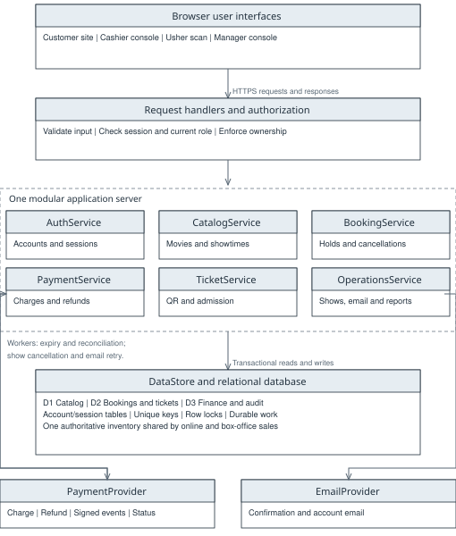
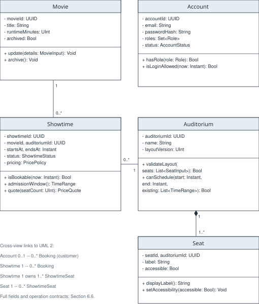
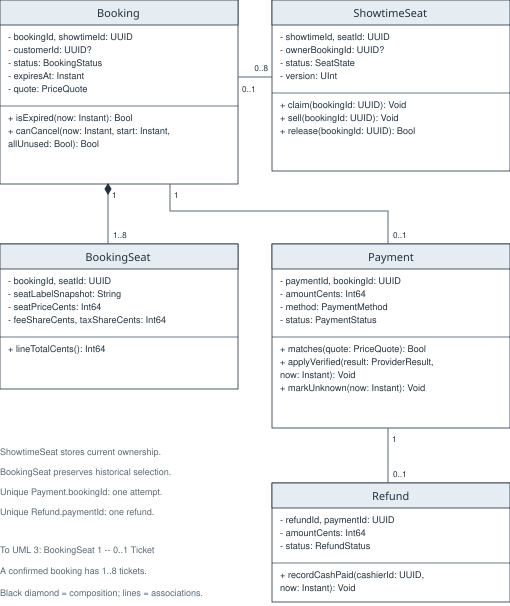
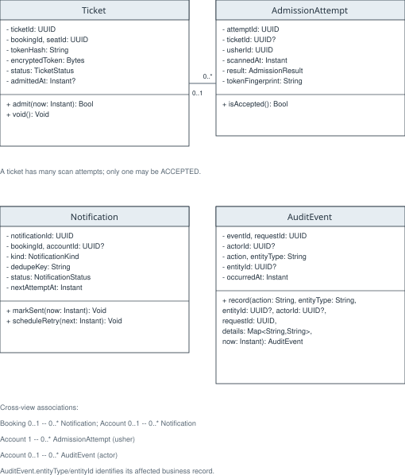
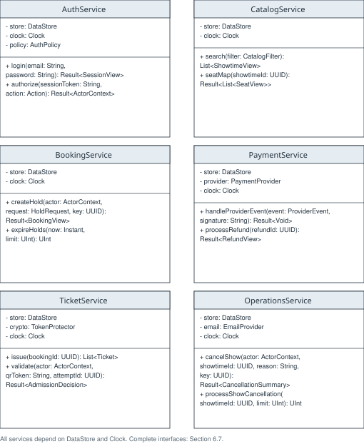

SMART CINEMA SYSTEM

Software Design Specification

Group #13

Khang Do

Minh Nguyen

Phu Pham

CS 250 - Introduction to Software Systems

Instructor: Gus Hanna, Ph.D.

Fall 2026

Design version 1.0 | October 7, 2026

Continuation of the Smart Cinema System requirements baseline dated September 22, 2026.

This document defines the software modules, class model, typed interfaces, transaction rules, and development plan for implementing the existing cinema requirements. The design is numbered as Chapter 6 so it can continue the same course project report.

## Document guide

| Section | Contents |
| --- | --- |
| 6.1 | System description and scope |
| 6.2 | SRS interpretation and design assumptions |
| 6.3 | Software architecture and architectural diagram |
| 6.4 | UML class diagram in four connected views |
| 6.5 | Data types, enums, and transfer records |
| 6.6 | Domain class responsibilities, attributes, and operations |
| 6.7 | Application services and external interfaces |
| 6.8 | Transaction rules and booking lifecycle |
| 6.9 | Persistence, security, and operational behavior |
| 6.10 | Requirement coverage and verification plan |
| 6.11 | Development timeline and member responsibilities |

Primary reference: Group #13, Smart Cinema System Software Requirements Specification, Version 1.0, September 22, 2026. Source locators below use the SRS section numbers and its printed body pages 1-9; the uploaded PDF has 14 physical pages.

Diagram notation: a minus sign marks a private attribute; a plus sign marks a public operation. A solid line is an association, and a filled diamond marks composition. Multiplicity describes the number of related objects. Full attribute and operation contracts follow the diagrams.

Implementation boundary: a single modular web application and a transactional relational database. This is a design proposal, not a claim that software has been implemented or performance-tested.

## 6 Software Design Specification

### 6.1 System description

The Smart Cinema System supports one cinema with multiple auditoriums. Customers browse movies and showtimes, select 1-8 seats, pay for tickets, receive QR tickets, review booking history, and cancel an eligible whole booking. Cashiers sell tickets and record cash transactions, ushers verify admission online, and managers maintain the catalog, schedules, prices, layouts, staff roles, reports, and show cancellations.

Every sales channel uses one authoritative seat inventory. A selection is held for five minutes as one unit. The server confirms a booking only after it has verified payment, the show is still available for sale, and all selected seats still belong to the live hold. Email and printing are delivery steps after that decision.

Version 1.0 excludes concessions, loyalty programs, streaming, multi-cinema management, partial cancellation, and seat exchange. Projection equipment remains outside the system. The design preserves the SRS card/cash paths, independent refund object, and single-use admission rule.

### 6.2 SRS interpretation and design assumptions

The following interpretations resolve wording gaps without removing the underlying requirements. Any later policy change follows the SRS Chapter 5 change process and updates this design and its tests.

| Item and SRS source | Interpretation used in this design |
| --- | --- |
| A1  Sections 3.2.1 and 3.2.2 | The processing text is displaced: 3.2.1.3 describes browsing; 3.2.2.3 describes holds. Both clauses are preserved in CatalogService and BookingService. Account behavior comes from their inputs/outputs, Use Case 1, and Section 3.5.4. |
| A2  Sections 2.3 and 3.4.1 | The domain roles Customer, Cashier, Usher, Manager take precedence over generic examples "admin, editor". Multiple roles may belong to one Account. |
| A3  Sections 3.5.4 and 3.3.3 | Guest reservation wording is handled with a scoped guest ownership token and contact email. A guest cannot set another user's customerId. Account history requires login; walk-in sales record the cashier and can use printing. |
| A4  Sections 2.5 and 4.3 | Booking stores both a reservation and its later booking state. Card failure or timeout expires the booking. Retry means a new hold after an inventory check. Cash goes directly from HELD to CONFIRMED. No separate two-minute payment deadline is present in this source. |
| A5  Sections 2.5 and 3.8 | Whole-booking cancellation returns the full captured amount, including the saved fees and tax. Fees/tax calculation is configurable. Each successful payment has at most one Refund record; retries update that record. |
| A6  Sections 2.5 and 3.9 | Cancellation is allowed exactly 30 minutes before start if every ticket is unused. Admission uses start minus 30 minutes inclusive to movie end exclusive. Cancellation and scanning serialize on the same booking/ticket records. |
| A7  Sections 3.4.2 and 3.4.4 | Rating and format are descriptive catalog fields. The movie runtime, schedule, layout and receipt values are snapshotted so later catalog edits do not change sold tickets or past receipts. |

### 6.3 Software architecture

The browser communicates with a single application server over HTTPS. Request handlers validate input and call six services. Each service owns a small set of use cases; shared data access applies transactions, uniqueness checks, and consistent locking. Background jobs run the same service code for expiry, financial reconciliation, show cancellation, and notification retry.

Figure 1. Layered architecture. External calls use adapters; all seat decisions use the same database.

#### 6.3.1 Component responsibilities

| Component | Responsibility |
| --- | --- |
| Presentation and request handlers | Responsive catalog, seat map, checkout, booking history, staff consoles, QR/manual admission and standard printing. Display venue-local times and explicit outcomes. Never decide that a payment succeeded. |
| AuthService | Registration, profile verification, recovery, login, session expiry, current staff roles and ownership checks. |
| CatalogService | Movie search, showtime filtering, room/seat layout, configured prices, publication, archiving and schedule conflict checks. |
| BookingService | Atomic holds, price/receipt snapshots, seat release, ownership, history and eligible whole-booking cancellation. |
| PaymentService | Card/cash records, verified provider events, one-time confirmation, late payment refunds, reconciliation and cash refund recording. |
| TicketService | One ticket per paid seat, protected QR credentials, authorized reprint/delivery, online one-time admission and duplicate scan records. |
| OperationsService | Manager show cancellation, durable cleanup, operational statuses, sales/refund reporting and email retries. |
| Persistence and jobs | One relational database with row locks and unique keys. Durable notification/refund/cancellation work survives restart. Jobs retry safely using saved keys. |
| External adapters | PaymentProvider accepts charges/refunds and exposes verified events/status. EmailProvider delivers messages. Providers have no direct authority over seat ownership. |

#### 6.3.2 Consistency with the existing analysis models

The SRS sequence diagram is implemented as payment verification, guarded booking confirmation, ticket creation, and customer confirmation. Its invalid-payment refund branch is handled before any ticket becomes usable. Admission checks consume one ticket atomically and store rejected duplicate scans.

The SRS DFD stores remain logical groups within one database: D1 is Movie, Auditorium, Seat and Showtime; D2 is Booking, BookingSeat, ShowtimeSeat, Ticket and AdmissionAttempt; D3 is Payment, Refund and AuditEvent. Account and notification tables support these processes. The supplied image depicts the customer flow; the staff interfaces call the same services and inventory.

The SRS state-transition diagram is preserved in Section 6.8. Refund state stays in Refund and is not added as a Booking state. An expired or cancelled booking cannot become confirmed after a late callback.

### 6.4 UML class diagram

The four views describe one class model. A class shown in one view retains the same identity in the other views. Section 6.6 lists all domain fields; Section 6.7 completes the service interfaces.

Figure 2. UML view 1. Catalog entities and account roles.

### 6.4.2 Booking and financial classes

Booking and financial classes. The diagrams show representative fields and operations; the following reference specifies the complete major interfaces.

Figure 3. UML view 2. Reservation ownership, historical seat lines, payment and refund.

### 6.4.3 Ticket and support classes

Ticket and support classes. The diagrams show representative fields and operations; the following reference specifies the complete major interfaces.

Figure 4. UML view 3. Admission, email work and audit records.

### 6.4.4 Application service classes

Application service classes. The diagrams show representative fields and operations; the following reference specifies the complete major interfaces.

Figure 5. UML view 4. Service dependencies and representative typed operations.

### 6.5 Data types and shared records

| Type | Meaning |
| --- | --- |
| UUID | Opaque globally unique identifier, stored with database uniqueness enforcement. Never inferred from a user-entered number. |
| String, Bytes, Bool | Validated Unicode text, binary bytes, and true/false. |
| UInt, Int64, Decimal | Nonnegative integer count, signed 64-bit integer money amount, and exact decimal descriptive rating. Money never uses floating point. |
| Instant, Date, TimeRange | UTC timestamp, calendar date without time, and a pair {start: Instant, end: Instant}. Display/report conversion uses one configured IANA venue time zone. |
| T?, List<T>, Set<T>, Map<K,V> | Nullable value, ordered collection, distinct collection, and key/value mapping. |
| Result<T> | {value: T?, error: ErrorCode?, message: String, requestId: UUID}; exactly one of value or error is meaningful. Result<Void> uses an explicit success flag. |
| Page<T> | {items: List<T>, nextCursor: String?}; page size is validated and bounded. |

#### 6.5.1 Enumerations

| Enum | Allowed values |
| --- | --- |
| Role | CUSTOMER, CASHIER, USHER, MANAGER |
| AccountStatus | PENDING_VERIFICATION, ACTIVE, DISABLED |
| ShowtimeStatus | DRAFT, PUBLISHED, CANCELLED |
| SeatState | AVAILABLE, HELD, SOLD |
| BookingStatus | HELD, PAYMENT_PENDING, CONFIRMED, EXPIRED, CANCELLED |
| PaymentMethod | CARD, CASH |
| PaymentStatus | PENDING, SUCCEEDED, FAILED, UNKNOWN |
| RefundStatus | PENDING, UNKNOWN, SUCCEEDED, FAILED, CASH_DUE |
| RefundReason | CUSTOMER_CANCEL, SHOW_CANCEL, INVALID_PAYMENT |
| TicketStatus | VALID, USED, VOID |
| AdmissionResult | ACCEPTED, DUPLICATE, UNKNOWN_TOKEN, UNPAID, VOID, TOO_EARLY, ENDED |
| NotificationStatus | PENDING, SENT, FAILED |
| NotificationKind | VERIFY, RECOVER, CONFIRMATION, CANCELLATION, REFUND_UPDATE |
| SaleChannel | ONLINE, BOX_OFFICE |
| DeliveryMode | SCREEN, PRINT, EMAIL |
| TokenPurpose | VERIFY_EMAIL, RESET_PASSWORD |
| Action | BROWSE, OWN_BOOKING, BOX_OFFICE, ADMIT, MANAGE_CATALOG, MANAGE_ROLES, CANCEL_SHOW, VIEW_REPORTS |

#### 6.5.2 Requests and policy records

| Record | Fields and validation |
| --- | --- |
| ActorContext | accountId: UUID?, roles: Set<Role>, guestSessionId: UUID?, requestId: UUID. Constructed from verified credentials on the server. A guest context has no staff roles. |
| RegistrationInput / ProfileInput | Registration: email: String, password: String, name: String, dateOfBirth: Date?. Profile: name: String, dateOfBirth: Date?. Validate lengths and date syntax. |
| MovieInput | title: String, runtimeMinutes: UInt, rating: Decimal?, language: String, format: String. Positive runtime and nonempty title. |
| SeatInput | seatId: UUID?, label: String, rowLabel: String, seatNumber: UInt, accessible: Bool, active: Bool. Distinct label and position within the room. |
| ShowtimeInput | movieId: UUID, auditoriumId: UUID, startsAt: Instant, pricing: PricePolicy. The UI converts a venue-local entry to UTC after resolving daylight-saving ambiguity. End time is computed from the movie runtime. |
| CatalogFilter / LocalDateRange | Filter: title: String?, localDate: Date?, language: String?, format: String?. Range: firstDate: Date, lastDate: Date inclusive, interpreted in the configured venue zone. |
| HoldRequest | showtimeId: UUID, seatIds: List<UUID>, customerId: UUID?, contactEmail: String?, channel: SaleChannel. Require 1..8 distinct seats. Customer identity comes from actor; only a cashier may explicitly attach a customer after authorization. |
| PricePolicy | seatPriceCents: Int64, bookingFeeCents: Int64, taxBasisPoints: UInt, taxableFees: Bool. Amounts are nonnegative and configurable by a manager; taxBasisPoints is bounded to a validated policy range. |
| PriceQuote | currency: String = USD, seatSubtotalCents: Int64, feeCents: Int64, taxCents: Int64, totalCents: Int64. Frozen when the hold is created. |
| ReceiptSnapshot | movieTitle: String, runtimeMinutes: UInt, language: String, format: String, auditoriumName: String, startsAt: Instant, endsAt: Instant, venueTimeZone: String, contactEmail: String?, quote: PriceQuote, billingReference: String?. Seat labels and line amounts come from BookingSeat; linked immutable payment data completes the receipt. |
| AuthPolicy | sessionIdleSeconds: UInt, sessionMaxSeconds: UInt, failureLimit: UInt, lockSeconds: UInt, tokenLifetimeSeconds: UInt, passwordHashParameters: Map<String,String>. Deployment settings require review; the SRS does not provide numeric values. |

Price calculation: seat subtotal = seat count x seat price. Taxable cents = subtotal + fee only when fees are taxable. Tax cents = floor((taxable cents x tax basis points + 5000) / 10000), using checked/wider integer arithmetic. Total = subtotal + fee + tax. Fee and tax shares are allocated evenly to sorted seat IDs; any remaining cents go to the first lines so line totals exactly equal the saved total.

#### 6.5.3 Responses and provider records

| Record | Fields |
| --- | --- |
| SessionView | sessionToken: String, expiresAt: Instant, profile: AccountPublic. Token is delivered in a protected cookie. AccountPublic = {accountId: UUID, name: String, email: String, roles: Set<Role>, status: AccountStatus}; hashes are never returned. |
| ShowtimeView / SeatView | ShowtimeView = {showtimeId: UUID, movieTitle: String, auditoriumName: String, startsAt: Instant, endsAt: Instant, price: PricePolicy, availableSeats: UInt, selectable: Bool}. SeatView = {seatId: UUID, label: String, accessible: Bool, status: SeatState}; no other customer identity. |
| BookingView | bookingId: UUID, status: BookingStatus, expiresAt: Instant, receipt: ReceiptSnapshot, seats: List<BookingSeat>, payment: PaymentView?, refund: RefundView?, cancellationCutoff: Instant, ticketIds: List<UUID>. |
| PaymentView / RefundView | PaymentView = {paymentId: UUID, status: PaymentStatus, amountCents: Int64, method: PaymentMethod}. RefundView = {refundId: UUID, status: RefundStatus, amountCents: Int64, currency: String, reason: RefundReason}; neither exposes provider secrets. |
| ProviderResult / ProviderEvent | ProviderResult = {transactionId: String, state: ProviderState, amountCents: Int64, currency: String, refundId: String?}. ProviderState = PENDING, SUCCEEDED, FAILED, UNKNOWN. ProviderEvent adds eventId: String, kind: EventKind, paymentId: UUID, refundId: UUID?, payload: Bytes. EventKind = PAYMENT or REFUND; the signature covers the raw payload. |
| TicketBundle / AdmissionDecision | TicketBundle = {bookingId: UUID, tickets: List<TicketView>}; TicketView = {ticketId: UUID, seatLabel: String, token: String, status: TicketStatus}. AdmissionDecision = {result: AdmissionResult, ticketId: UUID?, seatLabel: String?, message: String}. |
| CancellationSummary / SalesReport | CancellationSummary = {showtimeId: UUID, affectedBookings: UInt, pendingCleanup: UInt, pendingRefunds: UInt}. SalesReport = {range: LocalDateRange, cardSalesCents: Int64, cashSalesCents: Int64, refundsPaidCents: Int64, netCents: Int64, refundsDueCents: Int64, soldSeats: UInt}. |
| ServiceStatus | paymentHealth: HealthState, emailHealth: HealthState, unknownPayments: UInt, refundsDue: UInt, failedMessages: UInt, explanations: Map<String,String>. HealthState = AVAILABLE, DEGRADED, UNAVAILABLE. |
| ErrorCode | INVALID_INPUT, UNAUTHENTICATED, FORBIDDEN, NOT_FOUND, CONFLICT, SOLD_OUT, HOLD_EXPIRED, SHOW_UNAVAILABLE, CUTOFF_PASSED, TICKET_USED, PAYMENT_UNCERTAIN, PROVIDER_UNAVAILABLE. Error responses never imply a completed charge/refund without evidence. |

### 6.6 Domain class specifications

Domain methods are called by authorized services. Methods that change several records run inside a DataStore transaction; callers cannot persist a single seat or ticket update independently. The database supplies the current UTC time for a decision after locks are acquired. Fields marked nullable remain null until their stated event occurs.

#### 6.6.1 Account

Stores a customer or staff identity, profile, password hash, account state, and assigned roles. Customer and employee behavior is selected through roles, so separate Customer and Employee subclasses are unnecessary.

An account may create many bookings. A walk-in sale may have no customer account, but it always records the cashier account. Staff actions and role changes refer to the acting account.

| Attribute | Type | Description |
| --- | --- | --- |
| accountId | UUID | Primary key. |
| email | String | Normalized unique login address. |
| name | String | Display name. |
| dateOfBirth | Date? | Profile value described by the SRS; not a payment field. |
| passwordHash | String | Salted adaptive password hash; never a plaintext password. |
| roles | Set<Role> | Current CUSTOMER, CASHIER, USHER, or MANAGER assignments. |
| status | AccountStatus | PENDING_VERIFICATION, ACTIVE, or DISABLED. |
| roleVersion | UInt | Incremented on role changes; sessions must match current authorization. |
| failedAttempts | UInt | Count used by the configured login lock policy. |
| lockedUntil | Instant? | UTC end of a temporary login lock. |

`hasRole(role: Role): Bool`

Tests membership in the current role set. The service reloads roles for privileged requests; browser claims are not authoritative.

`isLoginAllowed(now: Instant): Bool`

Returns true only for an ACTIVE account that is not currently locked. A pending account can still use the verification flow.

#### 6.6.2 Movie

Stores the catalog description of a movie. Archiving removes it from new scheduling choices without deleting booking history.

One Movie is referenced by zero or more Showtimes. Bookings keep a separate receipt snapshot, so movie edits cannot change old receipts.

| Attribute | Type | Description |
| --- | --- | --- |
| movieId | UUID | Primary key. |
| title | String | Movie title. |
| runtimeMinutes | UInt | Positive running time used when a show is scheduled. |
| rating | Decimal? | Optional descriptive rating, including the SRS IMDB example. |
| language | String | Language displayed and searched in the catalog. |
| format | String | Descriptive format label; no new media delivery feature. |
| archived | Bool | Whether new showtimes may use this movie. |

`update(details: MovieInput): Void`

Validates title, positive runtime, and descriptive fields. Scheduled end times and historical receipt snapshots do not change automatically.

`archive(): Void`

Marks the movie archived. Existing shows and financial history remain stored.

#### 6.6.3 Auditorium

Identifies one room and the version of its seat layout. It provides the scheduling boundary for overlap and turnaround checks.

One Auditorium owns 1..300 Seats in the stated test configuration and hosts many Showtimes. The number 300 is a test scale, not a new business limit.

| Attribute | Type | Description |
| --- | --- | --- |
| auditoriumId | UUID | Primary key. |
| name | String | Unique room name within this cinema. |
| layoutVersion | UInt | Incremented after a valid layout edit. |
| active | Bool | Whether new shows may be scheduled here. |

`validateLayout(seats: List<SeatInput>): Bool`

Checks nonempty layout, distinct labels/positions, and valid accessibility values before a transaction replaces the future layout.

`canSchedule(start: Instant, end: Instant, existing: List<TimeRange>): Bool`

Returns true only when this interval plus at least 20 minutes of turnaround does not conflict with another noncancelled show. The caller must hold the auditorium scheduling lock.

#### 6.6.4 Seat

Stores the permanent position, label, and accessibility information of one auditorium seat. Availability belongs to a specific show, not to this class.

Each Seat belongs to one Auditorium. A seat may be referenced by many ShowtimeSeat rows and historical BookingSeat lines.

| Attribute | Type | Description |
| --- | --- | --- |
| seatId | UUID | Primary key. |
| auditoriumId | UUID | Owning auditorium. |
| label | String | Visible label such as A1; unique within the room. |
| rowLabel | String | Row or section label for the seating chart. |
| seatNumber | UInt | Positive position within the row. |
| accessible | Bool | Accessibility indicator presented with a text label. |
| active | Bool | Whether the seat is included in new layouts. |

`displayLabel(): String`

Returns the stored seat label used in charts and receipts.

`setAccessibility(accessible: Bool): Void`

Updates future layout metadata through the manager-only catalog service; existing show layouts and receipts retain their snapshots.

#### 6.6.5 Showtime

Stores one screening, its sale status, layout version, schedule, and price policy. It is the lock shared by inventory, payment confirmation, cancellation, and admission.

Each Showtime refers to one Movie and one Auditorium. It owns one ShowtimeSeat row per included seat and is referenced by many Bookings.

| Attribute | Type | Description |
| --- | --- | --- |
| showtimeId | UUID | Primary key. |
| movieId | UUID | Scheduled movie. |
| auditoriumId | UUID | Scheduled room. |
| layoutVersion | UInt | Frozen seat layout version for this show. |
| startsAt | Instant | UTC show start and sale cutoff. |
| endsAt | Instant | UTC start plus scheduled movie runtime; excludes turnaround. |
| status | ShowtimeStatus | DRAFT, PUBLISHED, or CANCELLED. |
| pricing | PricePolicy | Seat price, fee, and tax configuration in integer units. |

`isBookable(now: Instant): Bool`

Requires PUBLISHED and now < startsAt. Inventory availability is checked separately inside the same transaction.

`admissionWindow(): TimeRange`

Returns [startsAt - 30 minutes, endsAt). Admission at the exact movie end is rejected.

`quote(seatCount: UInt): PriceQuote`

Requires 1..8 seats. Computes the itemized USD total using checked integer arithmetic and the rounding rule in Section 6.5.

#### 6.6.6 ShowtimeSeat

Provides the single authoritative allocation row for a seat in one show. Both the public website and box office use these same rows.

Composite primary key (showtimeId, seatId). Each row has zero or one current owning Booking. Historical ownership is kept in BookingSeat, not overwritten here.

| Attribute | Type | Description |
| --- | --- | --- |
| showtimeId | UUID | Show being allocated. |
| seatId | UUID | Seat in the show's frozen layout. |
| status | SeatState | AVAILABLE, HELD, or SOLD. |
| ownerBookingId | UUID? | Current holder or purchaser; null only when AVAILABLE. |
| version | UInt | Incremented on allocation changes for stale-read detection. |

`claim(bookingId: UUID): Void`

Within a locked transaction, changes AVAILABLE to HELD with this owner. Calling it for a subset never commits a partial multi-seat hold.

`sell(bookingId: UUID): Void`

Changes HELD to SOLD only when the supplied booking owns the row and payment confirmation guards pass.

`release(bookingId: UUID): Bool`

Clears allocation only if the caller still owns it; otherwise returns false. This prevents an old expiry job from releasing a newer hold.

#### 6.6.7 Booking

Represents the reservation from its initial five-minute hold through payment, confirmation, expiry, or cancellation. The word reservation in the SRS maps to this same entity.

Each Booking contains 1..8 BookingSeat lines for one Showtime, has zero or one Payment attempt, and may create 1..8 Tickets. Cashier-created walk-in bookings need not have a customer account.

| Attribute | Type | Description |
| --- | --- | --- |
| bookingId | UUID | Unique hold and booking reference. |
| showtimeId | UUID | One selected show. |
| customerId | UUID? | Owning customer when registered. |
| createdById | UUID? | Customer or cashier who initiated the operation; null only for a scoped guest session. |
| guestTokenHash | String? | Ownership proof for a guest booking; never an arbitrary account ID. |
| contactEmail | String? | Delivery contact; a walk-in may use printing instead. |
| channel | SaleChannel | ONLINE or BOX_OFFICE. |
| status | BookingStatus | HELD, PAYMENT_PENDING, CONFIRMED, EXPIRED, or CANCELLED. |
| heldAt, expiresAt | Instant | Server creation time and heldAt + 300 seconds. |
| confirmedAt, cancelledAt | Instant? | Recorded only when the matching transition occurs. |
| quote | PriceQuote | Immutable hold-time price and billing breakdown. |
| receipt | ReceiptSnapshot | Immutable movie, show, room, seat, contact, and billing details. |

`isExpired(now: Instant): Bool`

Returns now >= expiresAt for an unconfirmed booking. Expiry never cancels an already confirmed booking.

`canCancel(now: Instant, start: Instant, allUnused: Bool): Bool`

Requires CONFIRMED, all tickets unused, and now <= start - 30 minutes. Manager show cancellation is a separate transition.

`transition(target: BookingStatus, now: Instant): Void`

Allows only the transitions in Section 6.8 after service guards pass. Sets the matching timestamp. EXPIRED and CANCELLED never return to CONFIRMED.

#### 6.6.8 BookingSeat

Stores an immutable line for each selected seat and its allocated share of the billed amount. It remains after a hold is released or a booking is cancelled.

Each BookingSeat belongs to one Booking and refers to one Seat. At most one Ticket is generated for a line; the pair (bookingId, seatId) is unique.

| Attribute | Type | Description |
| --- | --- | --- |
| bookingId, seatId | UUID | Composite primary key and ticket-generation key. |
| seatLabelSnapshot | String | Label at booking time. |
| seatPriceCents | Int64 | Original seat price in USD cents. |
| feeShareCents | Int64 | Allocated share of the booking fee. |
| taxShareCents | Int64 | Allocated share of the tax. |

`lineTotalCents(): Int64`

Returns seatPriceCents + feeShareCents + taxShareCents with overflow checks. Summing all booking lines must equal the quote total.

#### 6.6.9 Payment

Records one card or cash payment attempt for a booking, including uncertain outcomes. A network retry uses the same payment and provider key instead of creating a second charge.

Each Payment belongs to one Booking. A successful Payment has zero or one Refund. A failed or expired booking is retried by making a new booking after checking inventory.

| Attribute | Type | Description |
| --- | --- | --- |
| paymentId, bookingId | UUID | Unique payment ID; bookingId is also unique in this design. |
| method | PaymentMethod | CARD or CASH. |
| status | PaymentStatus | PENDING, SUCCEEDED, FAILED, or UNKNOWN. |
| amountCents | Int64 | Expected quote total; strictly positive for a payment. |
| currency | String | Expected currency: USD. |
| capturedAmountCents | Int64? | Verified funds actually captured; may differ from expected amount in an invalid transaction. |
| capturedCurrency | String? | Verified currency of captured funds; used to reverse an invalid transaction correctly. |
| providerTransactionId | String? | Unique card-provider reference when assigned. |
| idempotencyKey | UUID | Persisted key used for provider retries. |
| receivedCents, changeCents | Int64? | Cash tender and change; null for card. |
| recordedById | UUID? | Required cashier for a cash receipt. |
| createdAt, updatedAt | Instant | UTC processing timestamps. |

`matches(quote: PriceQuote): Bool`

Requires matching USD currency and exact billed amount.

`applyVerified(result: ProviderResult, now: Instant): Void`

Applies an authenticated provider outcome once. A proven success is not overwritten by a delayed failure; conflicting events trigger reconciliation.

`markUnknown(now: Instant): Void`

Records that a transport error prevents a reliable success/failure decision. It neither confirms a booking nor starts another charge.

#### 6.6.10 Refund

Tracks the return of a successful payment independently from booking state. A failed retry updates the same refund record.

Each Refund refers to one successful Payment. The database uniquely constrains paymentId, ensuring at most one refund object per successful payment.

| Attribute | Type | Description |
| --- | --- | --- |
| refundId, paymentId | UUID | Unique refund ID and unique payment reference. |
| amountCents | Int64 | Full verified captured amount; normally the original USD quote total. |
| currency | String | Original captured currency; normally USD. A provider discrepancy is reversed in that same currency. |
| reason | RefundReason | CUSTOMER_CANCEL, SHOW_CANCEL, or INVALID_PAYMENT. |
| status | RefundStatus | PENDING, UNKNOWN, SUCCEEDED, FAILED, or CASH_DUE. |
| providerRefundId | String? | Unique provider refund reference. |
| idempotencyKey | UUID | Stable key for every retry of this refund. |
| requestedAt, completedAt | Instant / Instant? | Request time and confirmed completion time. |
| paidById | UUID? | Cashier who actually handed back cash, when applicable. |

`applyVerified(result: ProviderResult, now: Instant): Void`

Updates a provider-confirmed result without duplicating the refund. A timeout becomes UNKNOWN until reconciled.

`recordCashPaid(cashierId: UUID, now: Instant): Void`

Permits CASH_DUE to SUCCEEDED once, with an authorized cashier and an audit entry. A repeated request returns the recorded completion.

#### 6.6.11 Ticket

Represents one paid seat and its one-time admission credential. The QR contains a random token, while lookup uses its hash.

Each Ticket belongs to one BookingSeat. It may have many AdmissionAttempts but at most one accepted attempt.

| Attribute | Type | Description |
| --- | --- | --- |
| ticketId | UUID | Unique ticket reference. |
| bookingId, seatId | UUID | Unique BookingSeat reference. |
| tokenHash | String | Unique hash of an unpredictable QR/manual-entry token. |
| encryptedToken | Bytes | Encrypted copy for authorized reprint and email delivery. |
| status | TicketStatus | VALID, USED, or VOID. |
| issuedAt | Instant | UTC issue time after valid payment. |
| admittedAt | Instant? | Set once on accepted admission. |

`admit(now: Instant): Bool`

Atomically changes VALID to USED and sets admittedAt; returns false if already used or void. The service checks show, booking, and time first.

`void(): Void`

Prevents admission after cancellation. It does not delete the ticket, its token hash, or earlier scan history.

#### 6.6.12 AdmissionAttempt

Records the outcome of an online QR scan or manual token entry, including unknown tokens and duplicate attempts.

Refers to a Ticket when lookup succeeds and always records the usher account. Unknown-token attempts have no ticketId.

| Attribute | Type | Description |
| --- | --- | --- |
| attemptId | UUID | Unique request identifier; a transport retry reuses it. |
| ticketId | UUID? | Matched ticket or null. |
| usherId | UUID | Authorized scanning employee. |
| scannedAt | Instant | UTC decision time. |
| result | AdmissionResult | ACCEPTED, DUPLICATE, UNKNOWN_TOKEN, UNPAID, VOID, TOO_EARLY, or ENDED. |
| tokenFingerprint | String | Hash used for investigation; raw token is excluded. |

`isAccepted(): Bool`

Returns whether the stored result is ACCEPTED. Repeating the same attemptId returns this saved result; a new scan after use receives DUPLICATE and is logged.

#### 6.6.13 Notification

Stores durable email work so payment confirmation does not depend on email uptime. It also supports verification and recovery email.

A notification may refer to a Booking or Account. Booking confirmation/cancellation rows are created in the same transaction as the business change.

| Attribute | Type | Description |
| --- | --- | --- |
| notificationId | UUID | Primary key. |
| bookingId, accountId | UUID? | Optional context references. |
| recipient | String | Validated destination email. |
| kind | NotificationKind | VERIFY, RECOVER, CONFIRMATION, CANCELLATION, or REFUND_UPDATE. |
| payloadRef | UUID | Reference to protected token data or a saved receipt. |
| dedupeKey | String | Unique logical message key. |
| status | NotificationStatus | PENDING, SENT, or FAILED. |
| attemptCount | UInt | Number of send attempts. |
| nextAttemptAt, sentAt | Instant / Instant? | UTC retry time and confirmed send time. |

`markSent(now: Instant): Void`

Records provider acceptance of this message without changing booking or payment state.

`scheduleRetry(next: Instant): Void`

Increments attemptCount and queues the next attempt under a bounded retry policy. Reaching the configured limit leaves FAILED visible to staff.

#### 6.6.14 AuditEvent

Keeps an append-only record of privileged actions, booking transitions, financial decisions, and admission rejections.

References the acting account when known and the affected entity by type and ID. Financial and reservation audit writes commit with their business change.

| Attribute | Type | Description |
| --- | --- | --- |
| eventId, requestId | UUID | Unique audit event and correlated request IDs. |
| actorId | UUID? | Account, or null for verified provider/system activity. |
| action | String | Controlled action name such as ROLE_CHANGED or DUPLICATE_SCAN. |
| entityType | String | Affected class name. |
| entityId | UUID? | Affected record when known. |
| occurredAt | Instant | UTC event time. |
| details | Map<String,String> | Minimal before/after state and reason; no secrets or card data. |

`record(action: String, entityType: String, entityId: UUID?, actorId: UUID?, requestId: UUID, details: Map<String,String>, now: Instant): AuditEvent`

Constructs an immutable event after redacting sensitive values. The repository only appends; ordinary application roles cannot edit or delete audit history.

### 6.7 Application services and function interfaces

Every public write validates request fields, authorizes the actor and ownership, and uses a unique request key. Repeating the same actor/action/key and request body returns the saved result; reusing that key with a different body returns CONFLICT. Client timestamps are never trusted. Worker-only methods are internal entry points and cannot be invoked directly by an ordinary browser session.

Expected business failures use Result<T>. Void domain methods report invalid transitions to their calling service, which rolls back the transaction. Unexpected database failures also roll back, return a safe error, and write operational diagnostics without secrets.

#### 6.7.1 AuthService

Manages registration, verification, sign-in, recovery, sessions, and immediate role enforcement.

| Dependency attribute | Type | Responsibility |
| --- | --- | --- |
| store | DataStore | Accounts, sessions, token records, and audit access. |
| clock | Clock | Trusted UTC time. |
| policy | AuthPolicy | Hashing, inactivity, lockout, and token-expiry settings. |

`register(input: RegistrationInput, key: UUID): Result<AccountPublic>`

Normalizes and uniquely checks email, hashes the password, creates a pending account and verification notification. Does not expose passwords in output.

`verifyEmail(token: String): Result<Void>`

Hashes and looks up the single-use token, checks expiry, activates the account, and consumes the token atomically.

`login(email: String, password: String): Result<SessionView>`

Checks account state and password, updates failed-attempt/lock fields, and returns an expiring secure session. Responses do not reveal which credential was incorrect.

`requestRecovery(email: String): Void`

Always returns a generic acknowledgement. For a known account, queues a single-use recovery token with an expiry.

`resetPassword(token: String, newPassword: String): Result<Void>`

Consumes a valid recovery token, hashes the new password, and invalidates existing sessions in one transaction.

`updateProfile(actor: ActorContext, input: ProfileInput): Result<AccountPublic>`

Updates the actor's name and date of birth after validation; returns a public profile with no authentication fields.

`assignRoles(actor: ActorContext, accountId: UUID, roles: Set<Role>, key: UUID): Result<Void>`

MANAGER only. Replaces role assignments, increments session authorization version, and records the change immediately.

`authorize(sessionToken: String, action: Action): Result<ActorContext>`

Checks a hashed session token, inactivity/absolute expiry, current account status, and current roles; enforces the action matrix. Touches lastActivityAt only for a valid session.

`logout(sessionToken: String): Void`

Revokes the matching session. Repeated logout is harmless.

#### 6.7.2 CatalogService

Reads the catalog and manages movies, seat layouts, prices, and conflict-free showtimes.

| Dependency attribute | Type | Responsibility |
| --- | --- | --- |
| store | DataStore | Catalog and inventory persistence. |
| clock | Clock | Trusted sale and schedule boundaries. |

`search(filter: CatalogFilter): List<ShowtimeView>`

Validates dates, filters title/language/format/local date, and displays current availability, room, and price. Sold-out, draft, cancelled, and started shows cannot be selected.

`seatMap(showtimeId: UUID): Result<List<SeatView>>`

Returns the show's frozen layout with authoritative availability after expiry cleanup. Responses are informational until a hold transaction succeeds.

`saveMovie(actor: ActorContext, movieId: UUID?, input: MovieInput, key: UUID): Result<Movie>`

MANAGER only. Creates or updates validated catalog fields. Archival and edits preserve existing booking snapshots.

`saveLayout(actor: ActorContext, auditoriumId: UUID, seats: List<SeatInput>, key: UUID): Result<Auditorium>`

MANAGER only. Validates labels and positions, locks the room, versions the layout, and preserves referenced seat identities. Existing show inventories remain frozen.

`saveShowtime(actor: ActorContext, showtimeId: UUID?, input: ShowtimeInput, key: UUID): Result<Showtime>`

MANAGER only. Locks the auditorium and relevant schedules, computes endsAt, enforces 20-minute turnaround in both directions, validates pricing, and initializes inventory. A published show with booking history cannot be moved; cancel and create a replacement.

`publishShowtime(actor: ActorContext, showtimeId: UUID, key: UUID): Result<Void>`

MANAGER only. Rechecks layout, price, schedule conflicts, and future start time, then publishes the show.

`archiveMovie(actor: ActorContext, movieId: UUID, key: UUID): Result<Void>`

MANAGER only. Invokes Movie.archive and appends an audit event. Does not cancel scheduled shows.

#### 6.7.3 BookingService

Owns atomic holds, reservation ownership, history, cancellation, and expiry. It performs every seat write through the same database.

| Dependency attribute | Type | Responsibility |
| --- | --- | --- |
| store | DataStore | Bookings, allocation rows, tickets, refunds, and durable work. |
| clock | Clock | Expiry and cancellation time source. |

`createHold(actor: ActorContext, request: HoldRequest, key: UUID): Result<BookingView>`

Validates 1..8 distinct seats, ownership/contact, show, and layout. Locks all target allocation rows, cleans expired owners safely, snapshots the price, and commits all seats or none. The key is scoped to actor/action.

`releaseHold(actor: ActorContext, bookingId: UUID, key: UUID): Result<BookingView>`

Owner or CASHIER cancels a live unpaid hold and releases only its owned seats. An in-flight payment remains reconcilable; later success creates a refund and never resurrects the hold.

`expireHolds(now: Instant, limit: UInt): UInt`

Worker uses trusted server time and bounded batches. Locks eligible HELD/PAYMENT_PENDING bookings, moves them to EXPIRED, and releases only matching allocations. Returns the number expired.

`history(actor: ActorContext, cursor: String?, limit: UInt): Result<Page<BookingView>>`

Returns only the authenticated customer's bookings and clear payment/refund status. A guest may retrieve only the specific booking bound to their guest token.

`getBooking(actor: ActorContext, bookingId: UUID): Result<BookingView>`

Checks ownership or permitted staff access. Includes the saved receipt, UTC values rendered in venue time, cancellation cutoff, and independent payment/refund state.

`cancelBooking(actor: ActorContext, bookingId: UUID, key: UUID): Result<RefundView>`

Owner, CASHIER, or MANAGER acting for that sale. Locks the show, booking and all tickets; requires the 30-minute cutoff and all tickets unused. Atomically cancels the whole booking, voids tickets, releases seats, creates/reuses its one refund and queues notifications. Cash refunds return CASH_DUE until handed back.

#### 6.7.4 PaymentService

Coordinates one charge per booking, signed provider events, reconciliation, and card or cash refunds.

| Dependency attribute | Type | Responsibility |
| --- | --- | --- |
| store | DataStore | Payments, refunds, requests, events, and bookings. |
| provider | PaymentProvider | External charge, refund, and status interface. |
| clock | Clock | Payment and validity time source. |

`startCard(actor: ActorContext, bookingId: UUID, paymentToken: String, key: UUID): Result<PaymentView>`

Owner or CASHIER only. Rechecks live hold, show and all allocations; writes PAYMENT_PENDING and one PENDING payment, then calls the provider outside the database transaction with its persisted key. Stores only the provider reference, not card data.

`recordCash(actor: ActorContext, bookingId: UUID, receivedCents: Int64, key: UUID): Result<BookingView>`

CASHIER only. Rechecks live hold/show/seat ownership and sufficient tender. Atomically stores a SUCCEEDED cash payment, exact change, CONFIRMED booking, SOLD seats, tickets, audit, and notification. Invalid holds must not accept cash.

`handleProviderEvent(event: ProviderEvent, signature: String): Result<Void>`

Verifies sender/signature and unique event ID. Checks transaction identity, exact amount/currency and current guards under locks. Valid success confirms once; invalid/late success records funds and queues the one refund. Browser redirects never call this as proof.

`reconcilePayment(paymentId: UUID): Result<PaymentView>`

Queries authoritative provider status with the existing reference/key, then applies the same confirmation/refund logic as an event. UNKNOWN is retained until resolved; retry does not recharge.

`processRefund(refundId: UUID): Result<RefundView>`

For a card refund, persists intent then calls the provider using the same refund key on every attempt. A verified response/event updates that same row; timeouts remain UNKNOWN.

`reconcileRefund(refundId: UUID): Result<RefundView>`

Queries provider refund status and updates the existing refund once. Permanent failure stays visible for manager review; it cannot mark money returned without evidence.

`recordCashRefund(actor: ActorContext, refundId: UUID, key: UUID): Result<RefundView>`

CASHIER only. Records actual full cash disbursement, cashier identity and timestamp once. Authorization alone or show cancellation leaves CASH_DUE.

#### 6.7.5 TicketService

Issues paid tickets, produces QR/print/email views, and makes online admission decisions.

| Dependency attribute | Type | Responsibility |
| --- | --- | --- |
| store | DataStore | Booking, ticket, and scan records. |
| crypto | TokenProtector | Secure random tokens, hashing, and protected token backups. |
| clock | Clock | Admission time source. |

`issue(bookingId: UUID): List<Ticket>`

Internal operation within confirmation transaction. Requires valid paid CONFIRMED booking and SOLD owned seats. Creates one unpredictable token per BookingSeat; a unique booking/seat key makes retries return existing tickets.

`deliver(actor: ActorContext, bookingId: UUID, mode: DeliveryMode, key: UUID): Result<TicketBundle>`

Owner or CASHIER only. Returns authorized QR/manual-entry tokens for display or standard printing, or queues email. Reprint reuses tokens and preserves USED/VOID status.

`validate(actor: ActorContext, qrToken: String, attemptId: UUID): Result<AdmissionDecision>`

USHER only and online. Hashes the token, locks show/booking/ticket, checks published noncancelled show, valid payment, confirmed booking and [start-30 minutes, end) window. Atomically consumes the ticket and stores the result; a second new scan is rejected and logged.

#### 6.7.6 OperationsService

Supports manager show cancellation, operational reports, durable email work, and provider health/status reporting.

| Dependency attribute | Type | Responsibility |
| --- | --- | --- |
| store | DataStore | Shows, bookings, work queue, audit and reporting views. |
| email | EmailProvider | Outbound email interface. |
| clock | Clock | Cancellation and reporting time source. |

`cancelShow(actor: ActorContext, showtimeId: UUID, reason: String, key: UUID): Result<CancellationSummary>`

MANAGER only and now < startsAt. Marks the show CANCELLED under its lock and persists cancellation work in the same transaction. Booking cleanup can run in batches; the show flag immediately blocks holds, payments and admission.

`processShowCancellation(showtimeId: UUID, limit: UInt): UInt`

Worker cancels remaining HELD/PAYMENT_PENDING/CONFIRMED bookings, releases owned seats, voids tickets, and creates/reuses refunds for successful payments. Pending payments remain monitored; their later success is refunded. Durable progress makes restarts safe.

`salesReport(actor: ActorContext, range: LocalDateRange): Result<SalesReport>`

MANAGER only. Converts venue-local day boundaries to UTC and reports captured card/cash sales, completed refunds, net receipts and outstanding refunds separately. Unknown payments are excluded from settled totals.

`sendPendingNotifications(now: Instant, limit: UInt): UInt`

Worker reads committed notification rows, renders saved receipt/token context, sends with a stable message ID, and records send or retry. Email failure cannot roll back a confirmed booking.

`retryRefund(actor: ActorContext, refundId: UUID, key: UUID): Result<RefundView>`

MANAGER only. Requeues the same eligible failed/unknown card refund for reconciliation and processing. It cannot increase the amount, create a second refund, or claim a cash refund was paid.

`serviceStatus(actor: ActorContext): Result<ServiceStatus>`

Permitted staff receive payment/email health plus actionable explanations for expiry, uncertain payments, duplicate scans, print failures and cash refunds due. Secrets and raw provider payloads are excluded.

#### 6.7.7 Infrastructure interfaces

`DataStore.transaction<T>(work: TransactionWork<T>): Result<T>`

Begins, commits or rolls back a unit of work. TransactionWork<T> = (repositories: RepositorySet): T is a callback receiving repositories bound to that transaction; RepositorySet is the typed collection of transaction-bound domain repositories. Repositories offer getById(id: UUID), save(entity: T), and the locked queries below; business guards remain in services.

| Interface operation | Return | Contract |
| --- | --- | --- |
| lockShow(showtimeId: UUID) | Showtime | Row lock shared by sales, cancellation and admission. |
| lockBooking(bookingId: UUID) | Booking | Row lock for lifecycle and cancellation/admission serialization. |
| lockSeats(showtimeId: UUID, seatIds: List<UUID>) | List<ShowtimeSeat> | Locks distinct seat keys in sorted order; returns exactly the requested existing rows or fails. |
| lockTickets(bookingId: UUID) | List<Ticket> | Locks all booking tickets before whole-booking cancellation or admission. |
| findExpired(now: Instant, limit: UInt) | List<UUID> | Bounded candidate scan; the transaction rechecks each candidate before mutation. |
| findByTokenHash(hash: String) | Ticket? | Unique indexed lookup; never scans decrypted tokens. |
| Clock.now() | Instant | Server/database UTC time; controllable test clock for boundary tests. |
| TokenProtector.createToken() | String | Cryptographically secure random token with at least 128 bits of entropy. |
| TokenProtector.hash(token: String) | String | Cryptographic lookup hash for high-entropy tokens; passwords use a separate adaptive password hash. |
| TokenProtector.encrypt(token: String) / decrypt(value: Bytes) | Bytes / String | Authenticated encryption/decryption; key comes from protected server configuration, separate from database backups. |

`PaymentProvider.charge(paymentId: UUID, amountCents: Int64, currency: String, paymentToken: String, key: UUID): ProviderResult`

Accepts a provider-issued payment token, unique request key, and exact amount. An uncertain transport outcome is returned as UNKNOWN. The same key must return the same transaction rather than charge again.

`PaymentProvider.refund(transactionId: String, amountCents: Int64, key: UUID): ProviderResult`

Returns funds from the original successful transaction. Reconciliation uses getPayment(transactionId: String): ProviderResult and getRefund(refundId: String): ProviderResult; when a reference is missing, getByKey(key: UUID): ProviderResult resolves the original operation.

`PaymentProvider.verifyEvent(payload: Bytes, signature: String): Bool`

Checks the configured provider signature and event freshness before any business record is changed. Verified unique event IDs are persisted with handling status to prevent replay.

`EmailProvider.send(message: EmailMessage, key: String): DeliveryResult`

EmailMessage = {to: String, subject: String, body: String}; DeliveryResult = {accepted: Bool, providerMessageId: String?, retryable: Bool}. Use notification.dedupeKey as a stable provider message key where supported. Delivery is at-least-once if the provider cannot deduplicate after an uncertain send; it never creates a second ticket or booking.

### 6.8 Transaction rules and lifecycle

#### 6.8.1 Holding and expiring seats

Use row-level transactions with a consistent lock order: auditorium when scheduling, then showtime, affected bookings ordered by ID, inventory rows ordered by seat ID, tickets, financial records, and supporting records. Within one show, its row lock serializes competing sales and cancellations. Never hold database locks while waiting on payment or email network calls.

1. Validate an actor-scoped request key, one bookable show, and 1-8 distinct selected seat IDs belonging to its frozen layout.

2. Start a transaction and lock the show. Read the database clock and reject now >= startsAt or a nonpublished show. Identify and lock any expired owner bookings before their inventory rows; expire them and clear only their owned allocations.

3. Lock every selected ShowtimeSeat in sorted order. If any row is absent, held by another live booking, or SOLD, roll back the whole request.

4. Create one HELD Booking with expiresAt = now + 300 seconds, immutable quote/receipt and 1-8 BookingSeat rows. Claim every selected inventory row. Save the request result and audit event, then commit.

5. An expiry worker scans by status/expiry, locks and rechecks candidates, transitions live unpaid bookings to EXPIRED, and clears owned rows. Hold creation and availability reads also run expiry cleanup so a delayed worker cannot preserve an invalid hold.

Seat availability is informational until step 4 commits. A second browser session cannot override a committed allocation. The database primary key allows only one ShowtimeSeat row per show/seat; owner-checked updates and the transaction enforce one live owner across both sales channels.

#### 6.8.2 Payment confirmation and recovery

Starting card payment moves HELD to PAYMENT_PENDING without extending the hold. The server persists one Payment and its provider key before sending a charge request. Cashier cash collection takes the direct HELD to CONFIRMED path only after tender, show validity and seat ownership are checked.

On a verified card success, lock the show, booking, all selected inventory rows and payment. Read current server time. Require a live PAYMENT_PENDING booking, now < expiresAt, now < startsAt, PUBLISHED show, matching amount/currency, and every seat still HELD by this booking. In one transaction record success, mark every seat SOLD, confirm the booking, issue all tickets, append audit, and queue confirmation email. If any write fails, roll back the entire confirmation and reconcile the provider transaction.

If funds were captured but any guard fails, store the financial result, expire a still-live invalid booking when appropriate, release its owned holds, and create/reuse a single INVALID_PAYMENT Refund. Keep EXPIRED or CANCELLED terminal. A missing/forged callback, browser success redirect, amount mismatch, or UNKNOWN result never creates a usable ticket. A mismatch is investigated and refunded against the actual verified captured amount, not the requested quote amount.

A definitive card failure moves PAYMENT_PENDING to EXPIRED and releases seats. An uncertain payment remains UNKNOWN and is reconciled while the five-minute hold may still be live; it expires at the existing deadline. An eventual late success produces a refund. Retrying checkout after an expired/failed booking starts a new booking with a new inventory check. A replay of an already accepted success returns its saved result; it does not reevaluate the original confirmation as a new late purchase.

#### 6.8.3 Cancellation and admission

Customer, cashier or manager booking cancellation locks the booking and all its tickets. Require now <= startsAt - 30 minutes and no USED ticket. Atomically cancel the full booking, void all tickets, release owned seat allocations, create/reuse the refund, append audit, and queue cancellation email. A card refund is processed after commit; a cash refund stays CASH_DUE until the cashier records actual payment. Cancellation is not undone when refund delivery is delayed.

Manager cancellation first locks a future show, requires now < startsAt, marks it CANCELLED and creates durable cleanup work. That committed flag immediately blocks all new holds, confirmations and admissions. A restartable worker cancels every affected active booking, voids tickets, releases allocations and creates one refund per successful payment. It continues monitoring pending payments; any later success is refunded. Reporting distinguishes cleanup/refunds pending from completed work.

Admission hashes a scanned or manually entered token. The online server verifies authorization, show state, paid confirmed booking, ticket state and the time window. It locks the same show/booking/ticket used by cancellation, then changes VALID to USED and records one ACCEPTED attempt. Two concurrent scans cannot both succeed. A new scan of a USED ticket is DUPLICATE and logged; retrying the same attemptId returns its earlier decision. Reprinting the same token cannot reset admission.

#### 6.8.4 Booking transitions

| From | Trigger and guard | To |
| --- | --- | --- |
| HELD | Start a card payment while hold, show and seats remain valid. | PAYMENT_PENDING |
| HELD | Authorized cashier records valid cash payment and sufficient tender. | CONFIRMED |
| HELD | Five-minute hold deadline is reached. | EXPIRED |
| HELD | Owner releases hold or manager cancels future show. | CANCELLED |
| PAYMENT_PENDING | Verified successful payment and all confirmation guards pass. | CONFIRMED |
| PAYMENT_PENDING | Definitive failure, invalid confirmation, or hold deadline. | EXPIRED |
| PAYMENT_PENDING | Owner releases hold or manager cancels future show; keep payment reconcilable. | CANCELLED |
| CONFIRMED | Eligible whole-booking cancellation, or manager cancels future show. | CANCELLED |
| EXPIRED / CANCELLED | Any later payment event; record/refund funds separately. | No booking transition |

### 6.9 Persistence and operational design

#### 6.9.1 Keys and database constraints

| Record or constraint | Implementation rule |
| --- | --- |
| Entity IDs and references | UUID primary keys; foreign keys preserve relationships. Use logical archive/deactivation instead of deleting referenced catalog, account or financial data. |
| Account and catalog | Unique normalized Account.email; unique (auditoriumId, label) and (auditoriumId, rowLabel, seatNumber). Positive movie runtime and valid start/end intervals. |
| Inventory | Primary key (showtimeId, seatId). AVAILABLE requires null owner; HELD/SOLD require an owner for the same show. Transactional guards prevent two active allocations. Frozen show layouts must match the auditorium. |
| Booking lines and tickets | Unique (bookingId, seatId) on BookingSeat and Ticket; Ticket references that composite key. Enforce 1..8 lines at service commit; an optional deferred database check can enforce aggregate count. Unique tokenHash. |
| Payment and refund | Unique Payment.bookingId, payment idempotencyKey and nonnull providerTransactionId. Unique Refund.paymentId, refund idempotencyKey and nonnull providerRefundId. Nonnegative integer amounts; refunds cannot exceed verified captured funds. |
| Admission and idempotency | Unique attemptId; a conditional update and unique accepted-ticket constraint permit one accepted admission per ticket. RequestRecord key = (actorScope, action, key); stores requestHash and resultRef. Same key/different request is a conflict. |
| Provider and work records | ProviderEventRecord key = (provider, eventId), with verified payload hash, state and result. Unique notification dedupeKey; unique cancellation job per show. Persist intent before external calls. |
| Snapshots and retention | Keep original receipt, BookingSeat lines and immutable payment facts. Never recalculate a past receipt from the current catalog. Do not hard-delete confirmed booking/payment/refund data as part of normal operations. |

Supporting persistence records are implementation structures rather than additional business classes: SessionRecord(sessionId: UUID, accountId: UUID, tokenHash: String, createdAt: Instant, lastActivityAt: Instant, expiresAt: Instant, roleVersion: UInt, revokedAt: Instant?); AuthTokenRecord(tokenId: UUID, accountId: UUID, tokenHash: String, encryptedToken: Bytes, purpose: TokenPurpose, expiresAt: Instant, consumedAt: Instant?); RequestRecord(requestId: UUID, actorScope: String, action: String, key: UUID, requestHash: String, resultRef: UUID?); ProviderEventRecord(provider: String, eventId: String, payloadHash: String, processedAt: Instant?); CancellationJob(showtimeId: UUID, cursor: UUID?, finished: Bool).

Account role changes increment the current authorization version stored with account roles; every protected request checks the current record. Role revocation takes effect immediately even if an older browser session remains open. Provider event receipt and business changes are committed together, or the event stays unprocessed for retry.

#### 6.9.2 Security and user experience

Use HTTPS, protected cookies, server-side session expiry, request forgery protection for cookie-authenticated writes, and a salted adaptive password hash. Recovery and verification tokens are random, single-use, hash-indexed and expiring. Encrypted backups support delivery where required. Never log passwords, raw session/recovery/QR tokens, full card details or provider secrets.

| Role | Allowed actions |
| --- | --- |
| Guest | Browse and use only a reservation bound to its own guest token/contact. Cannot choose another account ID or read account history. |
| Customer | Browse, manage own verified profile, create/pay/release own holds, see own history, retrieve own tickets and cancel eligible own bookings. |
| Cashier | Sell through the shared inventory, record card/cash sales, print/reprint permitted tickets, cancel eligible bookings and record cash refunds actually paid. |
| Usher | Online QR/manual validation and limited ticket/show details needed for admission. |
| Manager | Catalog/layout/pricing/schedule management, staff-role assignment, future-show cancellation, authorized refunds, operational reports and status. Cashier/usher privileges require those roles explicitly. |

The public interface uses responsive layouts, keyboard navigation, clear text labels and non-color-only seat states. The confirmation/cancellation views show venue-local cancellation cutoff and independent refund status. The staff console explains expired holds, unknown payment outcomes, duplicate scans, printing errors and cash refunds due. Camera permission failure offers manual token entry. A printing failure offers reprint without creating a new ticket.

#### 6.9.3 Reliability and performance

Index shows by publication/start/movie, allocation rows by show/seat, unpaid bookings by status/expiry, tickets by token hash, payments/refunds by provider reference and status, and notification work by state/next attempt. Keep lock transactions short; batch worker tasks and paginate history/report queries. No cache may override the database when confirming a hold, purchase or admission.

Measure under the SRS load: 500 concurrent browsers, 50 concurrent checkouts, up to 10 auditoriums with 300 seats each, and client round-trip latency no greater than 100 ms. Record catalog, hold, confirmation and admission latency separately from third-party time. A p95 target of 2 seconds for internal requests is a proposed interpretation of "a couple of seconds," not a completed benchmark. Verify expiry at the deadline through request-time cleanup and measure worker cleanup lag.

Use database backups and a documented restore drill. After restart, resume pending provider reconciliation, show-cancellation and email work. A committed confirmed booking must retain matching payment, sold seats and tickets; an uncommitted partial transaction must not appear. Deployment includes schema migration, regression checks and a rollback plan. The SRS does not specify numeric backup recovery or uptime targets, so those operational settings require agreement before deployment.

### 6.10 Requirement coverage and verification

These are planned acceptance checks, not claimed test results. SRS section references identify the source; the T labels identify design tests and do not replace missing SRS requirement IDs. Every service change should update the linked checks.

| Test and SRS source | Design and acceptance check |
| --- | --- |
| T01  2.5, 3.3.3 | BookingService.createHold: reject 0, 9 or duplicate seats; accept 1 and 8. Competing overlapping selections produce one complete winner and no partial loser hold. |
| T02  3.3.3, 3.2.2.3 | At expiresAt - 1 ms the owned hold may confirm; at expiresAt it cannot. Expiry releases all owned seats. A delayed old worker cannot release seats acquired by a newer booking. |
| T03  3.6, 3.7 | Run online and box-office requests concurrently for the same show/seat. Unique allocation plus locked confirmation never creates two active owners or paid tickets for the same active allocation. |
| T04  2.5, 3.2.1.3 | At now = startsAt, new holds and confirmations fail. Cancelled, draft, sold-out and started shows are not selectable. A stale catalog response cannot bypass purchase checks. |
| T05  4.1, 3.6 | A browser success redirect alone creates no ticket. Signed success with a wrong amount/currency or invalid/expired allocation records funds for investigation/refund and creates no usable ticket. |
| T06  3.1.3, 3.8 | Replay request/event IDs before and after the hold deadline. Charge, confirmation, ticket creation and refund effects occur once. A conflicting body under the same key is rejected. |
| T07  2.5, 4.3 | Cashier sale validates tender and exact change; a customer cannot record cash. Valid cash goes HELD to CONFIRMED atomically. Failed cash validation leaves no successful payment. |
| T08  3.8, 3.1.2 | Confirmed booking has one QR ticket per BookingSeat. Reprint uses the same encrypted token backup and same ticket IDs; tokens/hashes are unique and raw tokens stay out of logs. |
| T09  2.5, 4.1 | Before start-30 minutes reject admission; exactly at that time permit an unused paid ticket. At movie end reject. Concurrent different scan IDs accept once, reject/log the duplicate; same attempt ID returns the prior result. |
| T10  2.5, 3.9 | At start-30 minutes a whole unused booking may cancel; 1 ms later it may not. Any used ticket blocks customer cancellation. Concurrent cancellation/admission gives one valid serialized outcome. |
| T11  3.8, 4.3 | Repeated cancellation/refund retry produces one Refund per successful Payment. Unknown card refund is reconciled. Cash refund stays CASH_DUE until a cashier records actual disbursement. |
| T12  2.5, 4.1 | Cancel a future show while holds, payments and scans are active. Show flag blocks new work immediately; restartable cleanup cancels bookings, voids tickets and refunds known/late successes once. |
| T13  2.5, 3.4 | Two schedules in one room require at least 20 minutes after movie end in either order. Concurrent scheduling cannot overlap; cancel/create replaces a sold show instead of silently moving ticket times. |
| T14  3.4, 3.8 | Layout edits affect new shows only. Historic receipts keep original movie/time/room/seat/amount values after catalog edits. Referenced records cannot be hard-deleted. |
| T15  3.2.1, 3.3.1, 3.5.4 | Register/verify/login/recover with duplicate email, invalid or reused token, locked account and expired session. Generic recovery messages prevent account disclosure. Roles removed by manager stop working on the next request. |
| T16  3.5.4, 3.7 | A customer cannot access another booking; a guest cannot impersonate an account. Every staff operation enforces its required role. Audit changes commit with financial/booking state and expose no secrets. |
| T17  3.5.2, 3.5.3 | Crash after provider success but before local commit. Reconciliation produces one valid booking or one refund. Email outage leaves the booking valid and retries the same notification. |
| T18  3.7, 3.9 | Verify USD cent arithmetic including rounding/remainders and overflow. Store UTC; show receipt, cutoff and report dates in the configured venue zone, including daylight-saving boundaries. |
| T19  3.5.1, 3.5.6 | Measure stated load/latency profile. Test mobile/tablet/desktop layout, keyboard flow, text labels, manual ticket entry and browser printing. |
| T20  2.2, 3.5.2, 3.9 | Reports separate captured sales, refunds paid, pending refunds and net receipts. Restore a backup and replay durable work without duplicate seats, tickets or money effects. |

### 6.11 Development plan and timeline

The proposed plan covers four development weeks after the team approves the design. The course deadline was not supplied, so weeks are relative rather than invented due dates. Each member owns implementation, tests and documentation for a comparable portion; every merge receives a review from another member.

| Phase | Task and responsible member | Expected output |
| --- | --- | --- |
| Week 1 | Khang Do: application module structure, transaction rules, booking/inventory schema and UML integration. | Shared interface definitions; migration outline; concurrency scenarios T01-T04. |
| Week 1 | Minh Nguyen: account/role model, catalog, auditorium/seat layout and showtime interfaces. | Auth/catalog contracts; scheduling and role scenarios T13-T16. |
| Week 1 | Phu Pham: payment/refund, ticket/admission and external-provider contracts. | Provider test doubles; finance/admission scenarios T05-T12. |
| Week 2 | Khang Do: holds, expiry, history and ownership; Minh reviews. | Atomic 1-8 seat flow; release/retry behavior; booking screens. |
| Week 2 | Minh Nguyen: registration/login/recovery, catalog/search, manager layout and schedule editing; Phu reviews. | Verified accounts; protected roles; conflict-free published showtimes. |
| Week 2 | Phu Pham: card/cash flow, protected QR tickets, scan/reprint and basic email; Khang reviews. | Paid confirmation path; duplicate-safe tickets and online admission. |
| Week 3 | Khang Do: customer cancellation and whole-system concurrency integration. | Cutoff/race handling; no partial holds or double allocations. |
| Week 3 | Minh Nguyen: manager show cancellation UI, operational reports, role and accessibility tests. | Clear cancellation/refund statuses; correct local-time reports. |
| Week 3 | Phu Pham: late-payment/refund reconciliation, durable notification and cancellation workers. | Restart-safe financial cleanup and notification retry; failure tests. |
| Week 4 | All members: integrate, run T01-T20, review migrations/restore/rollback, revise design. Khang compiles; Minh checks SRS coverage; Phu checks diagrams and financial states. | Recorded test results; corrected interfaces; readable final PDF; tagged submission files and repository link. |

#### 6.11.1 Team member responsibilities

| Member | Primary ownership | Review responsibility |
| --- | --- | --- |
| Khang Do | Architecture, Booking/BookingSeat/ShowtimeSeat, inventory transactions, history/cancellation integration and final document assembly. | Review payment/admission integration; verify atomic confirmation and receipt consistency. |
| Minh Nguyen | Account and role flows; Movie/Auditorium/Seat/Showtime; scheduling, manager UI and reports. | Review booking ownership and expiry; check SRS coverage and time/price presentation. |
| Phu Pham | Payment/Refund/Ticket/AdmissionAttempt, notifications, provider adapters and reconciliation jobs. | Review auth/catalog permissions and schedule boundaries; verify financial and scan failure cases. |

#### 6.11.2 Milestones and completion criteria

Week 1 ends when the schema, UML and service contracts agree. Week 2 ends with one vertical path from browsing through a paid ticket and online admission. Week 3 ends when cancellation, provider failure, late callback, duplicate request and crash recovery paths behave consistently. Week 4 ends after planned checks have recorded outcomes, defects are resolved or explicitly tracked, and the requirements-plus-design report is exported and reviewed.

A task is complete only when its owner updates the affected source/design, records meaningful verification, and another member reviews it. These assignments describe planned responsibility; they do not certify work or commits already completed by any member.

#### 6.11.3 Repository contribution plan

Keep the existing requirements files and append this Design chapter to the same project report. Store the editable design and diagram source beside the PDF so later assignments can continue the document. Use small descriptive commits and preserve unrelated repository work.

| Member | Individual contribution to commit and push |
| --- | --- |
| Khang Do | Review and commit the architecture, booking/inventory design, integrated report and PDF export under his own GitHub identity. |
| Minh Nguyen | Individually review and improve account/catalog/showtime design, then add concrete role and scheduling boundary test cases with expected results. Commit and push those edits himself. |
| Phu Pham | Individually review and improve payment/refund/admission design, then add concrete late-payment, refund and duplicate-scan test cases with expected results. Commit and push those edits himself. |

Each member must push at least one real commit as required by the assignment. One person uploading files, listing all three names, or adding a co-author label does not demonstrate that each member pushed. After all three contributions are visible in the repository history, one group member submits the link to the final combined PDF. Verify the instructor can access the repository.
